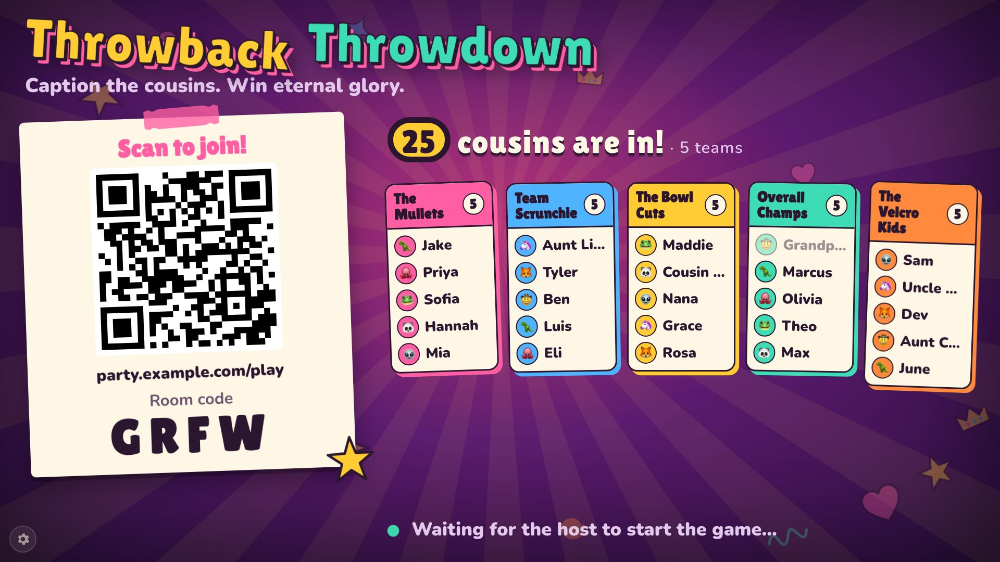
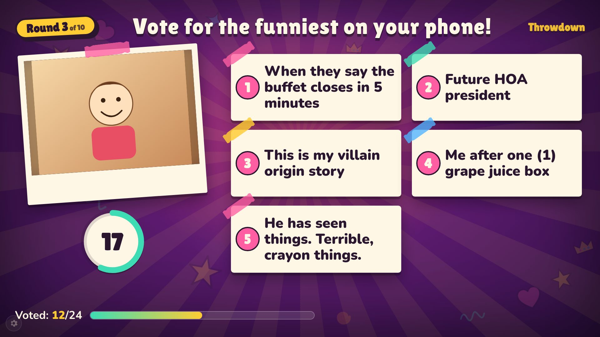
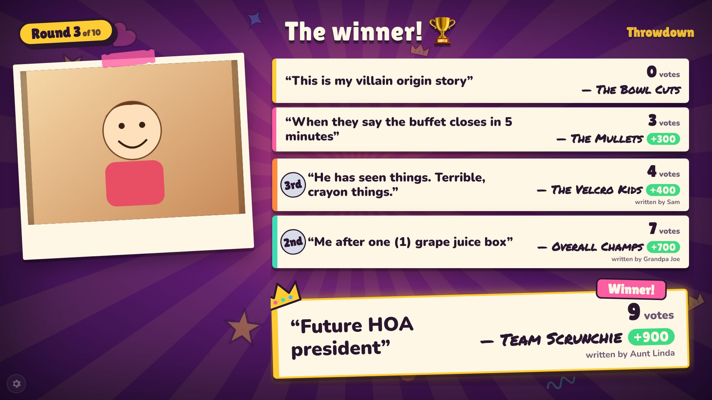
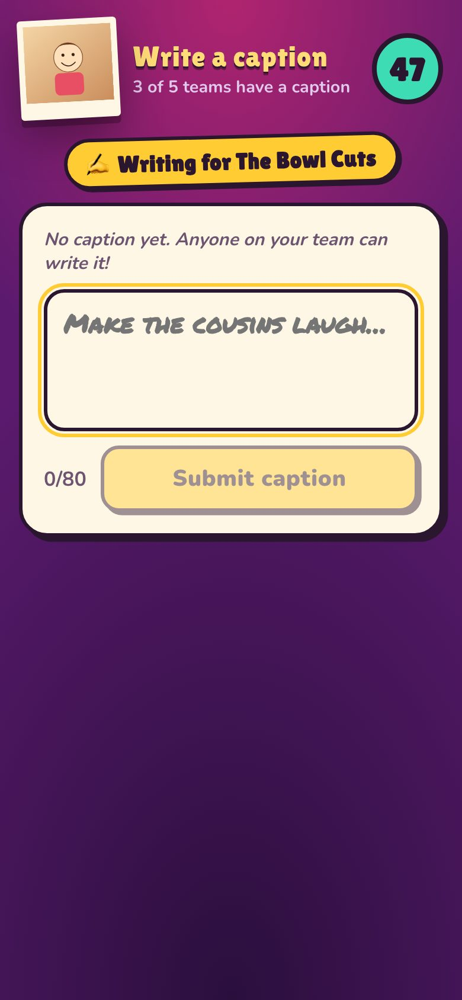
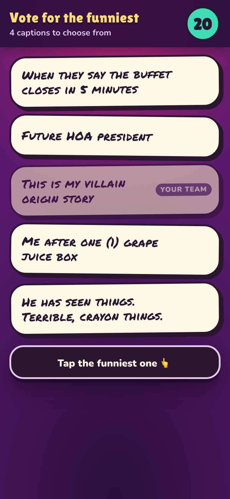
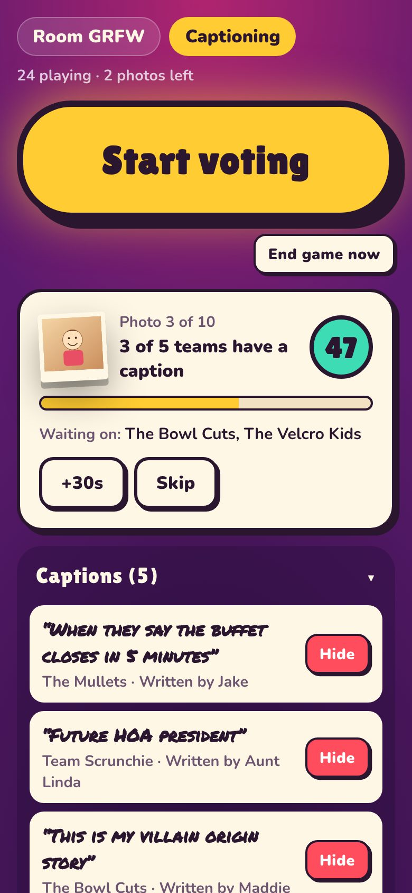

# Throwback Throwdown

**A photo-caption party game for big family gatherings.** A childhood photo of one of the cousins
goes up on the TV. Teams write the funniest caption they can on their phones. Everyone votes, the
TV reveals the winner with a drumroll, and points go to the team. Then the next photo comes up.

Built for a real cousin get-together of about 25 people in 5 teams: no app installs, no accounts,
just a QR code on the TV. It runs on one laptop.



| Voting on the TV | Results with the winning team |
|---|---|
|  |  |

| Writing a team caption | Voting on a phone | The host's controls |
|---|---|---|
|  |  |  |

## How it plays

1. **Join:** players scan the QR code on the TV and type a name. They're put on teams automatically, in join order.
2. **Photo reveal:** the host taps the big button and a polaroid flips onto the TV.
3. **Captions:** each team writes one caption. Anyone on the team can submit it, and a later submission replaces it.
4. **Voting:** everyone votes on their own phone for the funniest caption, but not for their own team's.
5. **Results:** the TV reveals the captions from fewest votes to most, then a drumroll and confetti for the winner.
   Each vote is worth 100 points, plus a 200-point bonus for a clean sweep.
6. **Scoreboard:** an animated leaderboard. Then the next photo, until the final podium.

Three screens, all in the browser:

| Screen | Who | URL |
|---|---|---|
| **TV** | The laptop plugged into the TV. It only displays; it doesn't play. | `/tv` |
| **Player** | Everyone, on their phones | `/play` (from the QR code) |
| **Host** | Whoever runs the game, on their phone, behind a 6-digit PIN | `/host` |

## Features

- **Teams or solo:** 2–8 teams with preset names that players can rename, or everyone for themselves.
- **One-button hosting:** a giant "next step" button, live "3 of 5 teams have a caption" status, +30s, skip,
  hiding captions, moving players between teams, kicking, and fixing scores.
- **Photos:** the host uploads from their camera roll (resized on the phone first), or you drop files into a folder beforehand.
- **Survives the real world:** phones that sleep or drop wifi rejoin their own team automatically.
  If the server restarts mid-game, it resumes with the same room code, players and scores.
- **Original soundtrack and sound effects:** phase-aware music that never plays over sound effects, plus
  several takes of each effect. All of it was composed in code and rendered in [Soundcraft](https://getartcraft.com/apps/soundcraft).
- **Four themes**, switchable from the TV's settings panel (press `S`). The phones follow along.
- **Built for a room:** TV text readable from across the room at 720p or 1080p, and phone screens designed for one thumb in a dim room.

## Quick start

You need **Node.js 22.9+**.

```sh
git clone https://github.com/jpatrickb/throwback-throwdown.git
cd throwback-throwdown
npm install
npm run party        # builds, then serves on http://localhost:3000
```

The terminal prints the **room code**, the **host PIN** and the URLs. Open `http://localhost:3000/tv` on the
computer that's connected to the TV. Then scan the QR code with a phone on the same wifi, and open `/host` on the host's phone.

To let phones join over cellular or from a different network, put the game behind a tunnel. See
**[docs/SELF-HOSTING.md](docs/SELF-HOSTING.md)** for Cloudflare tunnel setup, configuration, and a game-day checklist.

Want to try it without any phones? This plays a whole game with fake players:

```sh
npm run bots -- <ROOM_CODE> 12 http://localhost:3000 --host <HOST_PIN> --teams 4
```

## Make it yours

Everything you'd want to change lives in one place:

| What | Where |
|---|---|
| Game name and tagline | `client/src/brand.ts` |
| Every word on the phones | `client/src/phone/copy.ts` |
| Colors, fonts and themes | `client/src/theme/tokens.css` (one `[data-theme]` block per theme) |
| Team names and colors | `TEAM_PRESETS` in `shared/types.ts` |
| Timers and the number of teams | The host's Settings panel (or `DEFAULT_SETTINGS` in `shared/types.ts`) |
| Art (logo, backgrounds, mascot) | `client/src/theme/art.ts`, with image prompts in [docs/art-prompts.md](docs/art-prompts.md) |
| Music and sound effects | `client/src/audio/cues.ts`, with specs in [docs/music-briefs.md](docs/music-briefs.md) |

To preview any screen without a server, add `?mock=<PHASE>`: for example `/tv?mock=RESULTS`,
`/play?mock=VOTING`, `/host?mock=CAPTIONING`, plus `&theme=arcade` or `&solo=1`.

## Development

```sh
npm run dev          # server :3000 + Vite dev server :5173 (open localhost:5173/tv)
npm test             # unit tests: game engine, scoring, ranking, phone logic
npm run e2e          # Playwright: full game in Chrome + an iPhone/WebKit host
npm run typecheck
npm run screenshots  # regenerate the README images (after npm run build)
```

**Stack:** TypeScript end to end. The server is Node, Express 5 and Socket.IO. The client is React 19, Vite, Motion and Howler.js.
The server is authoritative: the game engine is a pure `(state, event) → state` reducer
(`server/engine.ts`), and every screen receives a full snapshot of what it should show. A reconnecting
phone therefore catches up instantly. The shared contract between server and screens is `shared/types.ts`.

```
server/      engine.ts (game rules), index.ts (sockets, timers), photos.ts, persist.ts
client/src/  screens/ (Tv, Play, Host), tv/, phone/, audio/, theme/
shared/      types.ts: state, views and events shared by everything
scripts/     bots.ts (fake players), fresh.ts, screenshots.ts
```

## How it was built

This game went from idea to party-ready in about two days, built with [Claude Code](https://claude.com/claude-code).
A lead agent wrote the plan and the shared contract, then split the work across a team of AI agents: engine, phones,
TV/graphics and audio. Each owned its own files and committed in parallel. The original plan, the agent
briefs and their status logs are in **[docs/build-log/](docs/build-log/)**, and the commit history shows the team at work.

## License

[MIT](LICENSE): code, art and audio. Fonts are from Google Fonts (SIL Open Font License).
